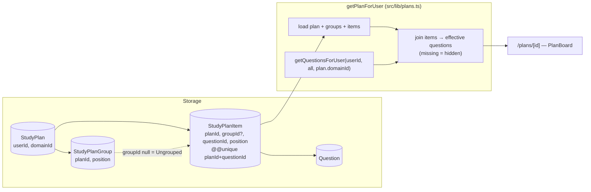
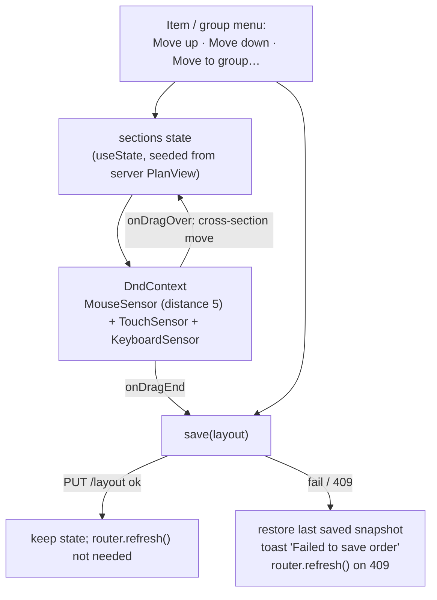

# Study Plans — Design (proposed)

> Design for **new** work against the approved [`requirements.md`](./requirements.md). File paths
> under "New" do not exist yet.

## High-level architecture

A study plan is **three new tables and a read-time join** onto the existing question read core. A
plan stores only ids and positions. Question content is never copied: every read resolves the
plan's items through `getQuestionsForUser`, so visibility, override merging, and stars behave exactly
as on `/questions`.



Writes go through REST route handlers under `src/app/api/plans/`, following the same shape as every
other API in the repo (`auth()` → Zod `safeParse` → Prisma → `NextResponse.json`). All ordering
changes go through a single **layout** endpoint that receives the whole arrangement at once.

## Main entry points

| Entry point | File |
|---|---|
| Plans list page | `src/app/(main)/plans/page.tsx` (new) |
| Plan page (read + edit) | `src/app/(main)/plans/[id]/page.tsx` (new) |
| Plan list / create | `GET`, `POST /api/plans` → `src/app/api/plans/route.ts` (new) |
| Plan read / update / delete | `GET`, `PATCH`, `DELETE /api/plans/[id]` → `src/app/api/plans/[id]/route.ts` (new) |
| Add group | `POST /api/plans/[id]/groups` → `src/app/api/plans/[id]/groups/route.ts` (new) |
| Rename / delete group | `PATCH`, `DELETE /api/plans/[id]/groups/[groupId]` → `.../groups/[groupId]/route.ts` (new) |
| Add questions | `POST /api/plans/[id]/items` → `src/app/api/plans/[id]/items/route.ts` (new) |
| Remove question | `DELETE /api/plans/[id]/items/[itemId]` → `.../items/[itemId]/route.ts` (new) |
| Save arrangement | `PUT /api/plans/[id]/layout` → `src/app/api/plans/[id]/layout/route.ts` (new) |
| Header nav entry | `src/components/layout/header.tsx` (changed) |

## Relevant files

### Reused unchanged

| File | Used for |
|---|---|
| `src/lib/questions.ts` — `getQuestionsForUser` | Resolving plan items to effective questions; also backs the picker via `GET /api/questions` |
| `src/app/api/questions/route.ts` | The picker's data source (`search`, `topicId`, `subTopicId`, `difficulty`, `limit`) |
| `src/components/questions/question-card.tsx` | Rendering each question in the plan (expand, answer, star, edit link, `lang`) |
| `src/components/questions/language-select.tsx`, `src/lib/use-display-language.ts`, `src/lib/language.ts` | `?lang=` selector and `pickTitle` for the picker rows |
| `src/components/questions/difficulty-badge.tsx` | Picker rows |
| `@dnd-kit/core`, `@dnd-kit/sortable`, `@dnd-kit/utilities` | Drag and drop — already installed and used by `src/components/topics/topic-list.tsx` |
| `src/components/ui/*` | `dialog`, `button`, `input`, `textarea`, `checkbox`, `select`, `dropdown-menu`, `scroll-area`, `skeleton`, `badge`, `card` |
| `sonner` | Toasts |
| `swr` | Plans list and picker fetching on the client |

### New

| File | Purpose |
|---|---|
| `prisma/migrations/20261110000000_add_study_plans/migration.sql` | The three tables |
| `src/lib/plans.ts` | Server-only: `getVisibleQuestionMap`, `getPlansForUser`, `getPlanForUser`, `findOwnedPlan`, `isLayoutCurrent`, `layoutToPositions`, `touchPlan` |
| `src/lib/plans-api.ts` | Route-handler guards: `requireUserId`, `requireOwnedPlan`, `getActiveDomainId`, `jsonError`, `readJson` |
| `src/components/plans/layout-state.ts` | Client-safe pure helpers over section state: `toLayout`, `moveItem`, `stepItem`, `moveGroup`, dnd id helpers (kept apart from `plans.ts` so Prisma never enters the client bundle) |
| `src/lib/validations/plan.ts` | Zod schemas (see *Validation*) |
| `src/types/index.ts` (changed, additive) | `PlanSummary`, `PlanView`, `PlanSectionView`, `PlanItemView`, `PlanLayout` |
| `src/components/plans/plan-list.tsx` | Plans list + "New Plan" dialog |
| `src/components/plans/plan-form-dialog.tsx` | Create / rename plan (name + description) |
| `src/components/plans/plan-board.tsx` | Client root of the plan page: holds layout state, DnD context, save logic |
| `src/components/plans/plan-section.tsx` | One section (Ungrouped or group): header, collapse, sortable item list, drop zone |
| `src/components/plans/plan-item.tsx` | Sortable wrapper: drag handle, number, `QuestionCard`, item menu |
| `src/components/plans/group-dialogs.tsx` | Add / rename group, delete-group choice dialog |
| `src/components/plans/question-picker.tsx` | Multi-select picker dialog |

### Changed

| File | Change |
|---|---|
| `prisma/schema.prisma` | New models + back-relations on `User`, `Domain`, `Question` |
| `src/components/layout/header.tsx` | Add `{ href: "/plans", label: "Study Plans" }` to `navItems` (SP-R36) |

Nothing in `questions-management`, `question-overrides`, or `domains` changes behavior, so their
docs are not amended.

## Data model

```prisma
model StudyPlan {
  id          String   @id @default(cuid())
  userId      String
  domainId    String?
  name        String
  description String?  @db.Text
  createdAt   DateTime @default(now())
  updatedAt   DateTime @updatedAt

  user   User             @relation(fields: [userId], references: [id], onDelete: Cascade)
  domain Domain?          @relation(fields: [domainId], references: [id], onDelete: SetNull)
  groups StudyPlanGroup[]
  items  StudyPlanItem[]

  @@index([userId, domainId, updatedAt])
}

model StudyPlanGroup {
  id        String   @id @default(cuid())
  planId    String
  name      String
  position  Int
  createdAt DateTime @default(now())
  updatedAt DateTime @updatedAt

  plan  StudyPlan       @relation(fields: [planId], references: [id], onDelete: Cascade)
  items StudyPlanItem[]

  @@index([planId, position])
}

model StudyPlanItem {
  id         String   @id @default(cuid())
  planId     String
  groupId    String?  // null = the built-in Ungrouped section (SP-R10)
  questionId String
  position   Int      // order within its section
  createdAt  DateTime @default(now())

  plan     StudyPlan       @relation(fields: [planId], references: [id], onDelete: Cascade)
  group    StudyPlanGroup? @relation(fields: [groupId], references: [id], onDelete: Cascade)
  question Question        @relation(fields: [questionId], references: [id], onDelete: Cascade)

  @@unique([planId, questionId])   // SP-B3
  @@index([planId, groupId, position])
}
```

Back-relations added: `User.studyPlans`, `Domain.studyPlans`, `Question.studyPlanItems`.

| Rule | Mechanism |
|---|---|
| Delete user → plans gone (SP-B6) | `StudyPlan.user` `Cascade` |
| Delete plan → groups + items gone (SP-R6) | `Cascade` on both |
| Delete question → item gone, others keep order (SP-R33) | `StudyPlanItem.question` `Cascade`; positions may now have a gap, which is harmless because reads sort by `position` and the next layout save re-densifies |
| Delete domain → plan unlisted (SP-B6) | `StudyPlan.domain` `SetNull`; list query filters on the active `domainId` |
| One question per plan (SP-B3) | `@@unique([planId, questionId])` |
| Delete group | Handled explicitly in the route (move or remove items first). The `Cascade` on `StudyPlanItem.group` is only a backstop. |

**Ungrouped as `groupId = null`** rather than a real row: it cannot be renamed, moved, or deleted
(SP-R10) and always exists, so a nullable FK expresses that with no special row to protect.

**Positions are dense integers `0..n-1`**, rewritten wholesale by the layout endpoint. There is no
unique constraint on `position`: rewriting N rows under a unique constraint would need a two-phase
update, and with a single writer per plan (the owner) plus the stale-layout check (SP-V4), order
uniqueness is kept by the write paths. Fractional/lexicographic ranks were rejected — with a
500-item cap, rewriting every position in one transaction is cheap and much simpler to reason about.

**Progress tracking is not precluded**: a later `completedAt` column on `StudyPlanItem` fits without
reshaping anything.

### Migration

A new hand-written-or-generated migration `add_study_plans`, applied with `prisma migrate deploy`
(never `migrate dev`: the local `.env` points at the production database). Purely additive — three
`CREATE TABLE`s, indexes, and FKs; no existing table is altered beyond the implicit relation, so it
is safe to deploy ahead of the code.

## Important types

```ts
// src/types/index.ts (additions)

export type PlanSummary = {
  id: string;
  name: string;
  description: string | null;
  questionCount: number; // visible items only (SP-X6)
  groupCount: number;
  updatedAt: Date;
};

export type PlanItemView = {
  id: string;            // StudyPlanItem.id
  questionId: string;
  /** null when the question is not visible to the owner right now (SP-R34, SP-R35). */
  question: QuestionWithRelations | null;
};

export type PlanSectionView = {
  id: string | null;     // null = Ungrouped
  name: string;          // "Ungrouped" for the null section
  items: PlanItemView[]; // ordered by position, hidden items included
};

export type PlanView = {
  id: string;
  name: string;
  description: string | null;
  domainId: string | null;
  isForeignDomain: boolean;   // plan.domainId !== user's active domain (SP-X2)
  sections: PlanSectionView[]; // Ungrouped first, then groups by position
};

/** Body of PUT /api/plans/[id]/layout — the complete arrangement. */
export type PlanLayout = {
  ungrouped: string[];                          // item ids, in order
  groups: { id: string; itemIds: string[] }[];  // groups in order, each with its item ids in order
};
```

## The read path — `getPlanForUser`

```ts
// src/lib/plans.ts
export async function getPlanForUser(userId: string, planId: string, activeDomainId: string | null): Promise<PlanView | null>
```

1. `prisma.studyPlan.findFirst({ where: { id: planId, userId }, include: { groups: { orderBy: position }, items: { orderBy: position } } })`. Not found or not owned → `null` (caller → `notFound()` / `404`, SP-P1).
2. If `plan.domainId` is non-null, call `getQuestionsForUser(userId, { limit: Number.MAX_SAFE_INTEGER }, plan.domainId)` and build `Map<questionId, QuestionWithRelations>`. If `plan.domainId` is null, the map is empty.
3. For each item, `question = map.get(item.questionId) ?? null`.
4. Bucket items into sections by `groupId`; Ungrouped first, then groups in `position` order.

Because step 2 reuses the list read core, **every visibility rule comes for free**: hidden-by-override,
another user's private question, a default flipped to private, a question from another domain — all
are simply absent from the map, and the item renders as hidden (SP-R34, SP-R35). Override merging
and `isImportant` are identical to `/questions` (SP-R32).

**Trade-off:** step 2 loads the whole domain's visible questions to show up to 500 of them — the same
in-memory pattern `/questions` already uses (questions-management Q-X1). Rejected alternative:
extracting the per-question merge out of `getQuestionsForUser` into a shared helper and querying only
the plan's `questionId`s. That is more efficient but restructures `src/lib/questions.ts`, which is
documented in two other features' design docs; not worth it at current data sizes. If it becomes
slow, that extraction is the follow-up, and it is a documented-structure refactor requiring those
docs to be amended.

`getPlansForUser(userId, activeDomainId)` (list page, `GET /api/plans`) uses a Prisma query with
`_count` for groups, and computes the visible question count (SP-X6) by intersecting each plan's
item `questionId`s with the id set from one `getQuestionsForUser` call for the active domain.
Ordered by `updatedAt desc` (SP-R7).

### Hidden items on the client

Hidden items are **sent to the client** with `question: null` and kept in the board's layout state,
but are not rendered and not numbered. This is what makes SP-R34 ("un-hiding brings it back in its
original position") work without extra bookkeeping: the hidden item rides along inside its section's
array, every drag uses `arrayMove` over the full array, so its neighbours shift around it, and the
layout `PUT` contains the full item set as SP-V4 requires. Only the item id and question id leak to
the client, both of which the owner already knows.

## API

All handlers: `const session = await auth()`; no session → `401 { error: "Unauthorized" }`. Every
plan-scoped route first calls `requireOwnedPlan(planId)` (`src/lib/plans-api.ts`), which does
`findFirst({ where: { id, userId } })` and returns `404 { error: "Not found" }` on miss (SP-P1).
Validation failures return `400 { error: issues[0].message }` (SP-V1). Successful writes also bump
`StudyPlan.updatedAt` (via `prisma.studyPlan.update({ data: { updatedAt: new Date() } })` in the same
transaction) so the list order (SP-R7) reflects edits to groups and items.

| Method & path | Body | Response |
|---|---|---|
| `GET /api/plans` | – | `PlanSummary[]` for the active domain |
| `POST /api/plans` | `{ name, description? }` | `201 { id }`; `domainId` = session's active domain |
| `GET /api/plans/[id]` | – | `PlanView` |
| `PATCH /api/plans/[id]` | `{ name?, description? }` | `200 { id }` |
| `DELETE /api/plans/[id]` | – | `200 { success: true }` |
| `POST /api/plans/[id]/groups` | `{ name }` | `201 { id }`, appended at `max(position)+1`; `400` past 50 groups |
| `PATCH /api/plans/[id]/groups/[groupId]` | `{ name }` | `200 { id }` |
| `DELETE /api/plans/[id]/groups/[groupId]?items=move\|remove` | – | `200 { success: true }` |
| `POST /api/plans/[id]/items` | `{ questionIds: string[], groupId: string \| null }` | `201 { added: string[], skipped: string[] }` |
| `DELETE /api/plans/[id]/items/[itemId]` | – | `200 { success: true }` |
| `PUT /api/plans/[id]/layout` | `PlanLayout` | `200 { success: true }`; `409` if stale |

### `POST /api/plans/[id]/items`

1. Validate body (`1..200` unique ids).
2. Reject with `400 "This plan belongs to another domain"` if `plan.domainId !== session.user.activeDomainId` (SP-X2).
3. If `groupId` is non-null, it must belong to the plan → else `404`.
4. **Visibility check (SP-R20, SP-E4):** compute the visible id set with `getQuestionsForUser(userId, { limit: MAX }, plan.domainId)`. If any requested id is not in it → `400 "Some questions are not available"` and nothing is added.
5. Split requested ids into `skipped` (already in plan) and `toAdd` (SP-E3).
6. Reject with `400 "A plan can hold at most 500 questions"` if `existing + toAdd > 500`.
7. In a transaction: `createMany` with `position = maxPositionInSection + 1 + index`, preserving request order (SP-R17); bump `updatedAt`. `skipDuplicates: true` covers a race against the unique key.

### `DELETE /api/plans/[id]/groups/[groupId]`

`items=move` (default when the group is empty): in a transaction, append the group's items to the end
of Ungrouped preserving their order (`groupId = null`, `position = maxUngrouped + 1 + i`), then delete
the group, then re-densify remaining group positions. `items=remove`: delete the group's items, then
the group. The UI only asks the question when the group has items (SP-R12); the count it shows is of
visible items, the action applies to all of them.

### `PUT /api/plans/[id]/layout` — the single reorder path

Covers SP-R13, SP-R21, SP-R22, SP-R23 with one endpoint.

1. Validate shape with `planLayoutSchema`.
2. Load the plan's current group ids and item ids.
3. **Stale check (SP-V4, SP-X1):** the set of group ids in the body must equal the plan's group set, and the union of `ungrouped` + every `itemIds` must equal the plan's item set, with no id appearing twice. Mismatch → `409 { error: "Plan changed, reloading" }`.

   `409` rather than `400`: the condition is a conflict with server state, not a malformed request, and a distinct status lets the client tell "refetch" apart from a bug. (SP-V4 was amended to say `409` during design.)
4. In one `prisma.$transaction`: for each group, `update position = index`; for each item, `update groupId, position = index within its section`; bump `updatedAt`.

Up to 550 single-row updates in one transaction. Acceptable at the caps; if it ever matters, a single
`UPDATE … FROM (VALUES …)` via `$executeRaw` is a drop-in replacement inside `src/lib/plans.ts`.

## UI

### `/plans` — `src/app/(main)/plans/page.tsx`

Server Component: `auth()` → `getPlansForUser` → renders `<PlanList plans={…} />`. `PlanList`
(client) shows cards (name, truncated description, `N questions · M groups`, updated date) linking to
`/plans/[id]`, an empty state, and a "New Plan" button opening `PlanFormDialog`. On create success →
`router.push('/plans/' + id)`.

### `/plans/[id]` — `src/app/(main)/plans/[id]/page.tsx`

Server Component: `auth()` → `await params` → `getPlanForUser(...)`; `null` → `notFound()` (SP-E8).
Renders a back link and `<PlanBoard plan={plan} />`. The plan header (name, description, counts,
edit/delete menu, `QuestionLanguageSelect`, "Add group", "Add questions") and the domain notice for
`isForeignDomain` live inside `PlanBoard`, because its toolbar opens the picker and dialogs that
share the board's state.

### `PlanBoard` — state and drag and drop



- **State**: `sections: PlanSectionView[]` plus `lastSaved` snapshot. Optimistic: mutate state first, then `PUT /layout` built from state (SP-R25).
- **Saves are serialized**: a ref holds the in-flight promise; a new save waits for it, so two quick drags cannot arrive out of order and trigger a false `409`.
- **DnD structure** — the standard dnd-kit multi-container pattern, the same library and sensor setup as `topic-list.tsx`:
  - one outer `SortableContext` over group ids (vertical) — group drag handle in each group header; Ungrouped is not in it (SP-R10);
  - one inner `SortableContext` per section over its item ids — `onDragOver` moves an item into another section's array as the pointer crosses, `onDragEnd` finalizes with `arrayMove`;
  - each section is also a `useDroppable` so an **empty** group accepts drops (SP-X4);
  - **no reflow during a drag**: whether Ungrouped is rendered is frozen at drag start. When it was hidden (no visible items), an item drag shows `UngroupedDropBar` instead — a fixed-position drop target floating near the top of the viewport, flagged `priority` so it wins the collision when hovered. Inserting a real section at drag start would push every group down under the pointer, and dropping the user's card into Ungrouped by accident;
  - **drag state follows dnd-kit**: the drop bar and frozen-Ungrouped logic read dnd-kit's own `active` (`useDndContext`, via the `DndActive` render-prop in `plan-section.tsx`), not only the board's `activeDrag` state. A pointer drag released before dnd-kit finishes starting it fires neither `onDragEnd` nor `onDragCancel`; without this the drop bar stayed on screen;
  - **collision**: item drags use `pointerWithin` preferring item hits over section zones; with no pointer (keyboard drag) they use `closestCenter` over **items only**, falling back to section zones only when no item exists — otherwise arrow keys landed on the card's own section and nothing moved. Group drags use `closestCenter` over groups;
  - `DragOverlay` renders a compact title-only preview, not the full card.
- **Touch (SP-X8)**: add `TouchSensor` with `{ delay: 200, tolerance: 5 }` so scrolling still works, paired with `MouseSensor` rather than `PointerSensor` (a pointer sensor would also claim touches and skip the hold delay); `topic-list.tsx` uses only Pointer + Keyboard.
- **Keyboard / buttons (SP-R13, SP-R23, AC-11)**: dnd-kit's `KeyboardSensor` with `sortableKeyboardCoordinates` gives keyboard dragging; in addition each item and group has a `DropdownMenu` with Move up / Move down / Move to group… / Remove. These call the same state mutation + save.
- **Numbering (SP-R27)**: computed at render by walking sections in order and counting only items with `question !== null`.
- **Collapse (SP-R30)**: `useState<Set<string>>` of collapsed section keys; not persisted. Ungrouped is not rendered when it has no visible items.
- **Cards**: `PlanItem` renders `<QuestionCard question={item.question} />` **without `onDelete`**, so the card's own trash button (which deletes or resets the *question*) is never shown in a plan; "Remove from plan" lives in the item menu. Star and the edit link work as on `/questions`; the edit link's `returnTo` is the plan URL because the card builds it from `usePathname()`.
- **After non-layout writes** (add, remove, group create/rename/delete, plan rename): call the API, then `router.refresh()` and reseed state from the new server props: the board compares the `plan` prop with the one it was seeded from during render and replaces local state when it changes (React's "adjust state when a prop changes" pattern). These writes first await the layout save queue so a refresh never races an in-flight reorder.

### `QuestionPicker`

A `Dialog` with: search `Input` (debounced 300 ms), topic / sub-topic `Select`s fed by the existing
`GET /api/topics` (SWR key shared with the sidebar), difficulty `Select`, a target-section `Select`
(Ungrouped + groups), and a scrollable checkbox list.

- Data: `useSWR('/api/questions?' + params + '&limit=201')`. The API is already domain-scoped and override-aware (SP-R14), and its filter semantics are exactly `/questions`' (SP-R15), including its known search-on-raw-HTML behavior (questions-management Q-X5).
- **Reaching every question (SP-X7)**: showing 200 rows; if 201 come back, a hint reads "Showing first 200 — refine your search". Every question is reachable by narrowing. Rejected: loading the whole collection into the dialog (the approach `RelatedQuestionSelector` takes with `limit=500`) — it silently truncates past 500.
- Rows show `pickTitle(q, lang)` stripped of HTML, `DifficultyBadge`, and, for questions already in the plan, a disabled checkbox plus "In: <group name>" (SP-R18), using the board's current state.
- Selection is a `Set<string>`; "Add N questions" posts ids **in picker display order** (SP-R17), then closes, toasts "Added N questions" (plus "M already in plan" if `skipped` is non-empty), and refreshes.
- The "Add questions" button is disabled with a tooltip when `isForeignDomain` (SP-X2).

## Validation — `src/lib/validations/plan.ts`

Uses `zod/v4`, matching `question.ts`.

```ts
export const planSchema = z.object({
  name: z.string().trim().min(1, "Name is required").max(100, "Name must be at most 100 characters"),
  description: z.string().trim().max(500, "Description must be at most 500 characters").optional().nullable(),
});
export const planUpdateSchema = planSchema.partial();
export const groupSchema = z.object({
  name: z.string().trim().min(1, "Group name is required").max(100, "Group name must be at most 100 characters"),
});
export const addItemsSchema = z.object({
  questionIds: z.array(z.string().min(1)).min(1).max(200)
    .refine((ids) => new Set(ids).size === ids.length, "Duplicate question ids"),
  groupId: z.string().min(1).nullable(),
});
export const planLayoutSchema = z.object({
  ungrouped: z.array(z.string()),
  groups: z.array(z.object({ id: z.string(), itemIds: z.array(z.string()) })).max(50),
});
```

An empty `description` is stored as `null`.

## Authorization

| Concern | Mechanism |
|---|---|
| Unauthenticated pages | Existing `src/middleware.ts` redirects to `/login` (no change; `/plans` is not public) |
| Unauthenticated API | `auth()` check in each handler → `401` |
| Ownership | `requireOwnedPlan` → `404` for missing **and** foreign plans (SP-P1, SP-B2); no admin bypass (SP-P2) |
| Group / item belong to plan | Sub-resource lookups are `findFirst({ where: { id, planId } })` → `404` |
| Question visibility on add | Visible id set from `getQuestionsForUser` (SP-R20) |
| Domain | Plan `domainId` set from `session.user.activeDomainId` on create and never updated (SP-B5) |

## Error handling

| Case | Server | Client |
|---|---|---|
| Validation | `400 { error }` | Toast with `error` (SP-E7) |
| Missing / foreign plan, group, item | `404` | Page → `notFound()`; API → toast "Something went wrong" |
| Invisible question on add | `400` all-or-nothing | Toast with `error` |
| Limit exceeded | `400` naming the limit | Toast with `error` |
| Stale layout | `409` | Revert, toast "Failed to save order", `router.refresh()` |
| Network / 5xx on layout | – | Revert to `lastSaved`, toast "Failed to save order" (SP-E6) |

## Dependencies on other features

- **questions-management** — `getQuestionsForUser` and `GET /api/questions` are consumed as-is; their known limitations (in-memory filtering, raw-HTML search) are inherited by the plan view and picker.
- **question-overrides** — merge and `isHidden` are honored implicitly through the read core.
- **domains** — plan is stamped with and listed by the active domain.
- **authentication** — session, `activeDomainId` on the session, middleware redirects.
- **rich-text-editor** — none directly; cards render stored HTML via the existing `QuestionCard`.

## Implementation decisions worth noting

- **One layout endpoint instead of per-move endpoints.** Every drag, button move, and cross-group move becomes "send the whole arrangement". It makes the stale check trivial, keeps the client logic to plain array manipulation, and needs exactly one server code path for positions.
- **Hidden items travel to the client as placeholders** so the full-set layout contract and SP-R34 hold without server-side re-slotting.
- **Server-persisted order**, deliberately unlike the `localStorage` topic order (`src/lib/topic-order.ts`), because a plan is content the user expects on every device (SP-R26).
- **No new dependencies.** dnd-kit is already installed.

## Testing harness

The repo has no test runner (see `testcases.md`, to be written). Nothing in this design requires one
to be added, but the layout stale check and the add-items visibility check are pure enough to unit
test if a runner is introduced.
